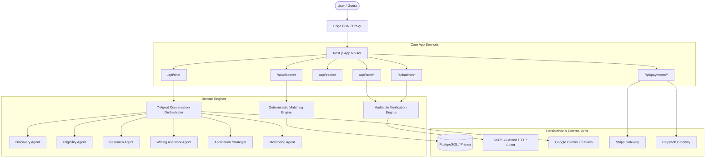
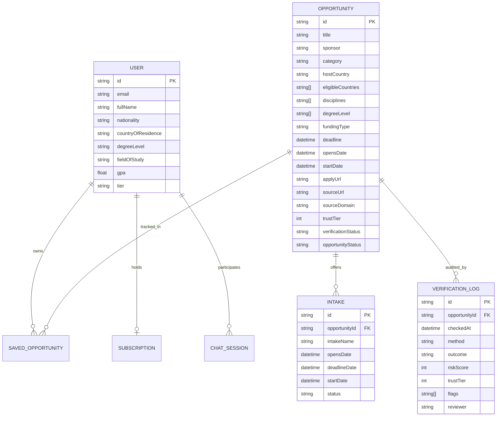
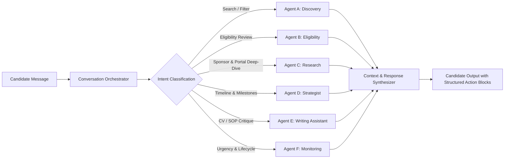

# AtlasFind System Architecture & Technical Specification

## 1. High-Level Architecture Overview

AtlasFind is an AI-powered opportunity intelligence platform built on Next.js 16 (App Router), PostgreSQL via Prisma ORM, Supabase Auth, and Google Gemini 2.5 Flash.

---

## 2. Database Schema & Data Models

AtlasFind's data models are managed through Prisma ORM with strict relationships and integrity constraints:

### 2.1 Key Entity Distinctions
- **`deadline` vs `startDate` / `Intake`**: An opportunity's application deadline (when candidates must submit) is explicitly separated from the programme start date (when accepted candidates commence studies or work). This directly enables filtering for start dates (e.g. January 2027 internships) where the application deadline occurred in autumn 2026.
- **`verificationStatus` vs `opportunityStatus`**: Verification status (`verified`, `unverified`, `flagged`, `requires_review`) tracks source authenticity and integrity. Lifecycle status (`active`, `closing_soon`, `expired`, `upcoming`) tracks application availability. Expired opportunities retain their verified status without destroying audit history.

---

## 3. Concrete 7-Agent AI Assistant Architecture

The AI layer in `src/lib/agents/` implements a modular multi-agent system:

### Agent Responsibilities:
1. **Discovery Assistant (`discoveryAgent.ts`):** Converts freeform natural language queries into structured query parameters. Accurately identifies seasonal dates, specific start windows (e.g., January 2027), disciplines, degree levels, and funding requirements.
2. **Eligibility Assistant (`eligibilityAgent.ts`):** Performs factual cross-referencing between candidate attributes and opportunity requirements. Returns transparent status (`ELIGIBLE`, `POTENTIALLY_ELIGIBLE`, `NOT_ELIGIBLE`) and highlights missing information.
3. **Research Assistant (`researchAgent.ts`):** Verifies the sponsor's institutional pedigree, investigates official documentation requirements, and validates portal URLs.
4. **Application Strategist (`applicationStrategistAgent.ts`):** Constructs backward-planned milestone schedules with submission checkpoints, recommendation letter buffers, and testing dates.
5. **Writing Assistant (`writingAssistantAgent.ts`):** Governed by strict anti-ghostwriting policies. Analyzes applicant essays and resumes for structure, tone, clarity, and thematic alignment, without fabricating achievements or writing essays on behalf of users.
6. **Monitoring Assistant (`monitoringAgent.ts`):** Tracks deadline proximity (<14 days triggers `CLOSING_SOON` urgency flag) and lifecycle state transitions.
7. **Conversation Orchestrator (`conversationOrchestrator.ts`):** Manages multi-turn conversation memory, synthesizes specialist agent insights, and outputs structured UI blocks (`:::opportunity`, `:::profile`).

---

## 4. Auditable Verification Engine

Located at `src/lib/verification/engine.ts`, the verification engine protects users from fraudulent opportunities, dead links, and phishing scams:

1. **SSRF Guard (`isSafePublicUrl`):**
   - Blocks private IPv4 ranges (`10.0.0.0/8`, `172.16.0.0/12`, `192.168.0.0/16`, `127.0.0.0/8`).
   - Blocks loopback targets (`localhost`, `127.0.0.1`, `::1`, `[::1]`).
   - Blocks AWS and GCP cloud metadata endpoints (`169.254.169.254`, `metadata.google.internal`).
   - Restricts protocols strictly to `http:` and `https:`.

2. **Domain Trust Tiering:**
   - **Tier 1 (Authoritative):** Accredited educational and government institutions (`.edu`, `.gov`, `.ac.uk`, `.int`, `.gov.tr`, etc.) and verified international organizations (Chevening, DAAD, Fulbright, CERN, ESA, World Bank).
   - **Tier 2 (Reputable):** Established publishers, research institutes, and recognized foundations.
   - **Tier 3 / Untrusted (High Risk):** Free blog services (`*.blogspot.com`, `*.wordpress.com`, `*.wixsite.com`), open form providers, and URL shorteners (`bit.ly`, `tinyurl.com`).

3. **Exploitation & Fraud Signatures:**
   - Detects pay-for-acceptance scams, non-refundable processing fees requested via Western Union, MoneyGram, cryptocurrency, or gift cards.
   - Flags generic webmail contact addresses (`@gmail.com`, `@yahoo.com`) pretending to represent official university or government bodies.

---

## 5. Security & Authentication Architecture

1. **Constant-Time Administrative Authorization (`src/lib/auth/adminAuth.ts`):**
   - All admin endpoints (`/api/admin/review`, `/api/admin/opportunities`, `/api/admin/scrape-sources`) enforce Bearer token validation.
   - Uses `crypto.timingSafeEqual` with byte-length verification to prevent timing attacks.
   - Fails closed in production if no secret is configured.

2. **Payment Webhook Verification (`src/lib/payments/`):**
   - **Stripe:** Validates cryptographic signature using `stripe.webhooks.constructEvent`.
   - **Paystack:** Validates HMAC-SHA512 payload signature using constant-time comparison.
   - Wraps database subscription updates and user tier modifications inside atomic `prisma.$transaction` calls.

3. **Compound User-Resource Ownership (IDOR Defense):**
   - All tracker routes (`/api/tracker/remove`, `/api/tracker/move`, `/api/tracker/update-details`) verify user session through `getVerifiedUser()` and scope mutations strictly to `where: { id: resourceId, userId: authenticatedUser.id }`.

